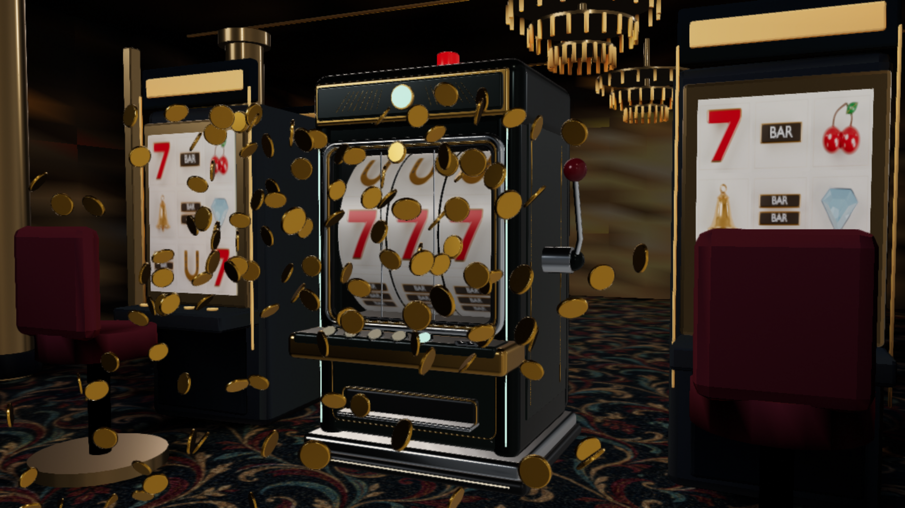
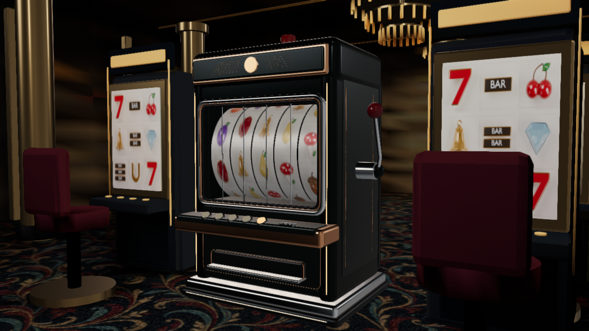
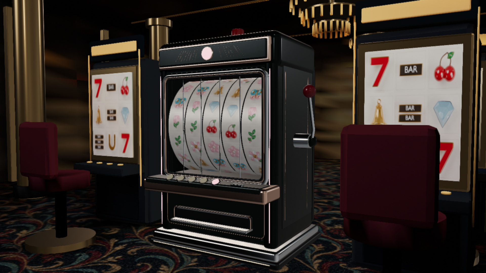
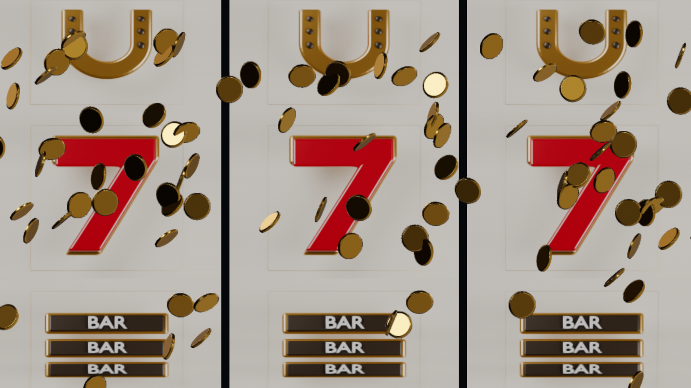
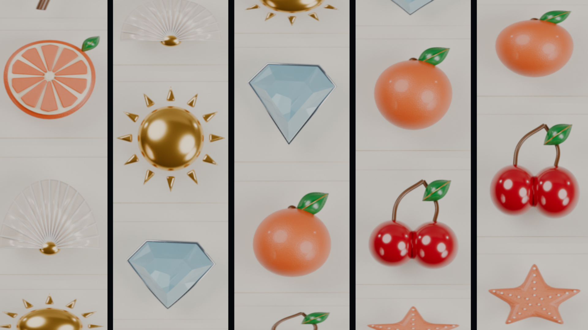
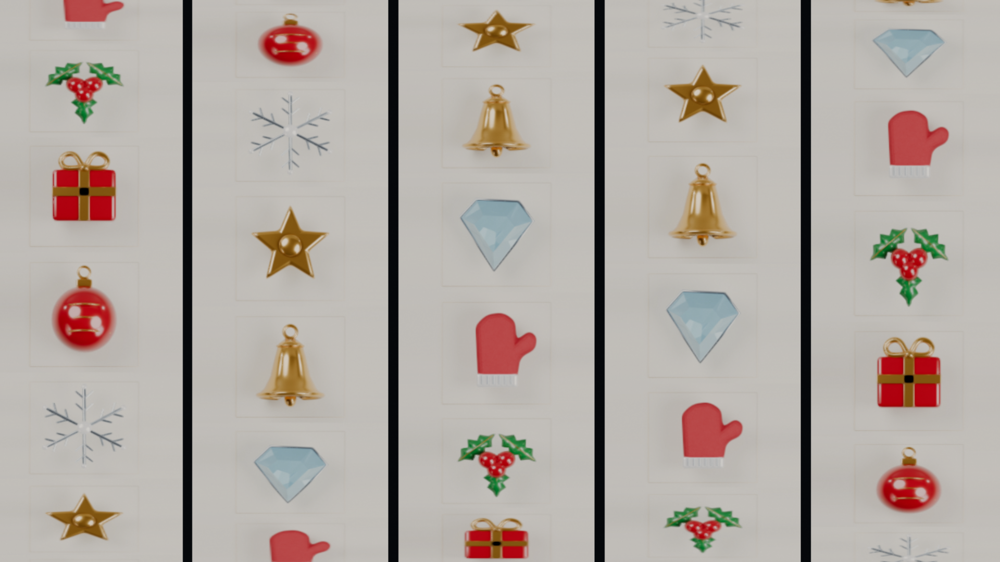
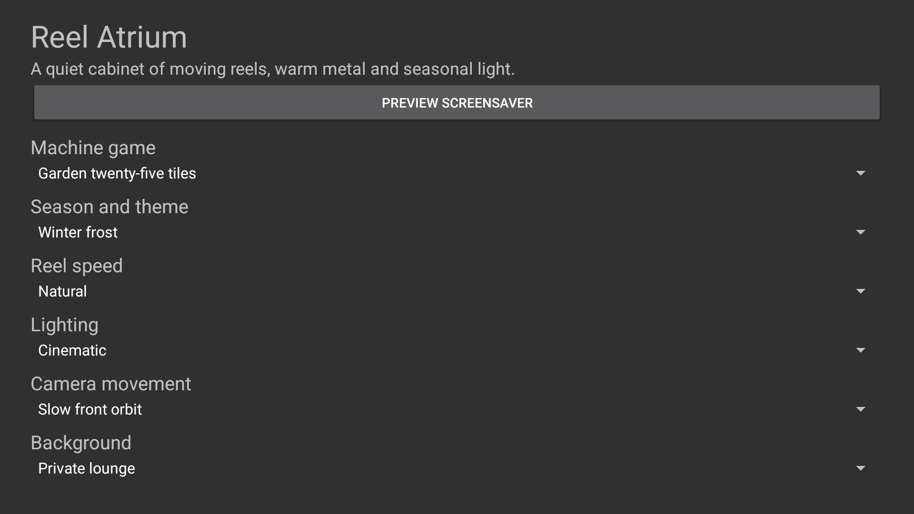

<p align="center">
  <a href="https://github.com/jeremykenedy/slot-vision#gh-light-mode-only"><picture><source media="(max-width: 600px) and (prefers-reduced-motion: reduce)" srcset="art/banner-mobile-still-light.476f80a3f155.svg"><source media="(prefers-reduced-motion: reduce)" srcset="art/banner-still-light.6bb6ba84b7e7.svg"><source media="(max-width: 600px)" srcset="art/banner-mobile-light.dfd0ae7e94a9.svg"></picture></a>
  <a href="https://github.com/jeremykenedy/slot-vision#gh-dark-mode-only"><picture><source media="(max-width: 600px) and (prefers-reduced-motion: reduce)" srcset="art/banner-mobile-still-dark.d274279a8fb1.svg"><source media="(prefers-reduced-motion: reduce)" srcset="art/banner-still-dark.7e263b16cb3e.svg"><source media="(max-width: 600px)" srcset="art/banner-mobile-dark.4b4704ad1559.svg"></picture></a>
</p>
<p align="center">A native TV screensaver with dimensional slot cabinets, moving reels and seasonal light.</p>
<p align="center">
  <a href="https://github.com/jeremykenedy/slot-vision/actions/workflows/ci.yml"></a>
  <a href="LICENSE"></a>
</p>
<p align="center">
  <a href="https://github.com/jeremykenedy"></a>
  <a href="https://github.com/jeremykenedy/slot-vision/stargazers"></a>
  <a href="https://github.com/sponsors/jeremykenedy"></a>
</p>

Show some love by starring this repository on GitHub.

The first public APK release is pending final Fire TV verification. The source, build steps and current [device evidence](docs/VERIFICATION.md) are available here.

## Table of contents

- [Requirements](#requirements)
- [Installation](#installation)
- [Fire TV Toolkit](#fire-tv-toolkit)
- [Quick start](#quick-start)
- [Features](#features)
- [Configuration](#configuration)
- [Privacy](#privacy)
- [Testing](#testing)
- [Documentation](#documentation)
- [Screenshots](#screenshots)
- [License](#license)

## Requirements

Android API 23 or later, an OpenGL ES 3 renderer and a landscape display. Physical device compatibility and sustained performance require device testing; see the [verification matrix](docs/VERIFICATION.md). A computer installation uses Python 3 and ADB. Building requires JDK 21, Android SDK platform 36 and build-tools 36.0.0.

## Installation

Download the signed APK and its SHA-256 file from [Releases](https://github.com/jeremykenedy/slot-vision/releases). The guided installer verifies the published checksum before installing the latest version:

```sh
python3 install.py --serial YOUR_TV_IP:5555
```

Run the same command to update while retaining app preferences. The APK keeps its package and signing identity. To use a locally built APK, pass `--apk build/slot-vision.apk`. The installer installs the app without changing TV timers or screensaver selection. Before removal, select another screensaver in the TV settings or Toolkit, then run:

```sh
python3 install.py --serial YOUR_TV_IP:5555 --uninstall
```

Uninstalling removes this app's preferences. [Installation details](docs/INSTALLATION.md).

## Fire TV Toolkit

[Fire TV Toolkit](https://github.com/jeremykenedy/fire-tv-toolkit) provides guided ADB setup, verified screensaver installation, launcher choices, screensaver and sleep timers, and supported settings protection.

```sh
git clone https://github.com/jeremykenedy/fire-tv-toolkit.git
cd fire-tv-toolkit
node setup.js
firetv-screensavers --install=slot-vision --yes
firetv-set-screensaver --set=slot-vision --yes
```

To update, repeat `firetv-screensavers --install=slot-vision --yes`. To remove, choose another saver first, then run `firetv-screensavers --uninstall=slot-vision --yes --force`. Fire TV UI discovers the installed DreamService and opens its settings. Its Install screensavers catalog can install a published APK after the host catalog is updated with the verified release. These commands require a Toolkit release containing the Slot Vision entry.

## Quick start

Open Slot Vision from the TV app launcher, select **Preview screensaver**, and use Back to return. Select the game, season, reel speed, lighting, camera orbit, background and cabinet or fullscreen view with the D-pad. Set Slot Vision as the TV's screensaver through the platform settings or Toolkit.

## Features

- Classic three-reel, five-reel palace and five-by-five garden layouts.
- Spring blossom, summer sun, autumn harvest and winter frost themes.
- Real perspective geometry, curved reel strips, layered cabinet trim and original symbols.
- Settled payline outcomes, proportional flying gold coins and a pulsing jackpot beacon.
- Fullscreen reels without a machine, with the same winning outcomes and coin showers.
- Continuous front camera orbit and a choice of private lounge or casino floor.
- Remote settings with persistent choices and Random for each option.
- No wagers, currency, purchases, accounts, ads, analytics or tracking.

Camera movement shifts the whole scene to reduce fixed imagery. It cannot guarantee protection against image retention or panel damage.

## Configuration

| Setting | Choices | Default |
| --- | --- | --- |
| Game | Classic 3x3, palace 5x3, garden 5x5, random | Classic |
| Season | Midnight atrium, spring, summer, autumn, winter, random | Midnight atrium |
| Speed | Relaxed, natural, lively, random | Natural |
| Lighting | Dim, cinematic, bright, random | Cinematic |
| View | Slot machine, fullscreen reels, random | Slot machine |
| Camera | Slow front orbit, slow wide front orbit, random | Slow front orbit |
| Background | Private lounge, casino floor, random | Private lounge |

Random resolves when a scene starts. All options are stored locally. [Settings and provider contract](docs/CONFIGURATION.md).

## Privacy

The app requests no Android permissions and contains no networking client, runtime content downloads, remote configuration, analytics or telemetry. Models, textures and lighting maps are bundled in the APK. The separate computer installer contacts GitHub to download releases only when the user runs it.

## Testing

```sh
bash test.sh
bash build.sh
```

Host tests enforce 100% line and branch coverage for `ReelOptions`, `ReelRound` and the standalone installer. Android lifecycle, framework settings and OpenGL output require native testing and are not represented by that host coverage figure. CI builds an unsigned review APK; release signing keys stay outside the repository. [Testing boundaries](docs/TESTING.md).

## Documentation

- [Building](docs/BUILDING.md)
- [Installation](docs/INSTALLATION.md)
- [Configuration and host contract](docs/CONFIGURATION.md)
- [Architecture](docs/ARCHITECTURE.md)
- [Testing](docs/TESTING.md)
- [Verification and screenshot provenance](docs/VERIFICATION.md)
- [Releasing](docs/RELEASING.md)
- [Release notes](docs/releases/v1.0.0.md)
- [Changelog](CHANGELOG.md)

Host developers: [integration contract](docs/INTEGRATION.md).

## Screenshots

Captured from the current native app on the API 34 Google TV emulator. The display captures are 1920x1080; the renderer uses a 1280x720 surface. Scenes are not retouched.

<table>
  <tr>
    <td></td>
    <td></td>
    <td></td>
  </tr>
  <tr>
    <td></td>
    <td></td>
    <td></td>
  </tr>
  <tr>
    <td></td>
  </tr>
</table>

## License

This project is open-sourced software licensed under the [Apache License 2.0](LICENSE).
